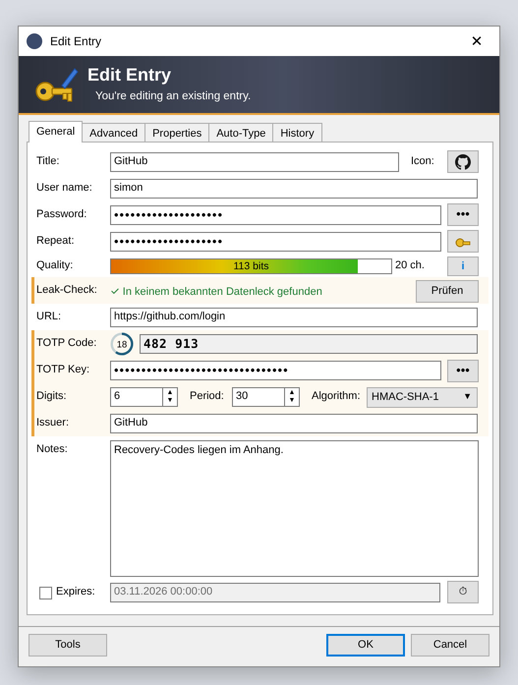
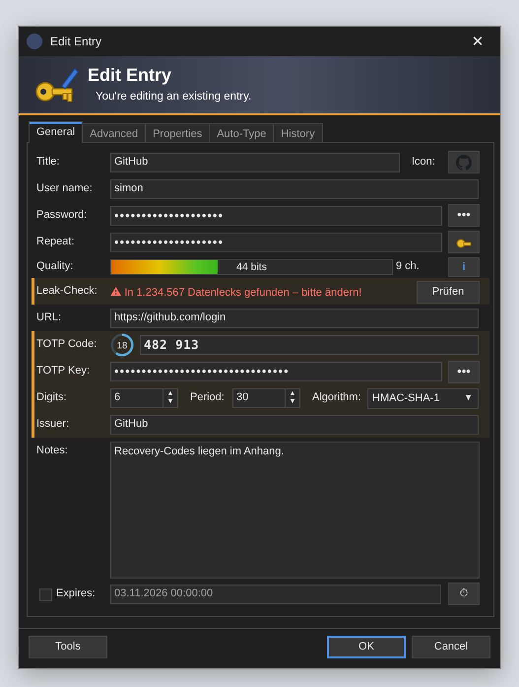
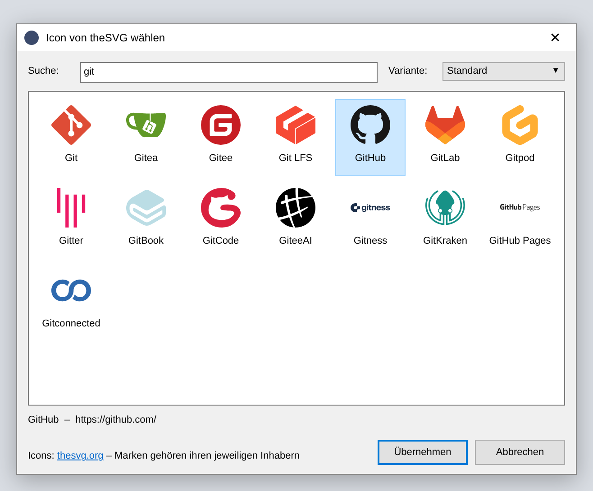

# BetterPass – Plugin for KeePass 2.x

**English** · [Deutsch](README.md)

[](LICENSE) [](https://github.com/Sormik/betterpass/releases/latest)

BetterPass adds five features to KeePass 2.x (version 2.47 or later). All settings are under **Tools → Options → BetterPass** or **Tools → BetterPass → Einstellungen** (Settings).

> **Status:** Version 1.1.0. The password generator's profiles and password generation are tested with KeePass 2.62 on Windows 11; the dialogs and the other features have not yet been tested by hand. The images below are rendered previews of the planned interface, not real screenshots.
>
> **Language:** The plugin's own interface is in German. Menu and dialog labels quoted below are given as they appear in the plugin, with an English translation in parentheses.

| Entry dialog | Dark mode | Icon picker |
|---|---|---|
|  |  |  |

## Features

### TOTP fields in the entry dialog
On the **General** tab, below **URL**, you get these fields:

- **TOTP Code**: a flat card with the current code in large type (the digit groups are separated by a drawn line that is never copied), a slim countdown ring (orange during the last 5 seconds) and a copy button. You can also copy by double-clicking, pressing Space or Ctrl+C. The clipboard is cleared automatically after KeePass' clipboard timeout. Without a key, or with an invalid key, the card shows a hint.
- **TOTP Key**: masked by default. Pasting an `otpauth://totp/...` link fills in all fields automatically, plus title and user name if they are still empty.
- **Digits** (1–8), **Period**, **Algorithm** (SHA-1, SHA-256, SHA-512) and **Issuer**.

**Storage format:** BetterPass uses KeePass' native fields `TimeOtp-Secret-Base32`, `TimeOtp-Length`, `TimeOtp-Period` and `TimeOtp-Algorithm`, plus `TimeOtp-Issuer`. This means `{TIMEOTP}` works in Auto-Type even without the plugin.

A KeePassXC `otp` field is read. When editing, it is only updated if BetterPass fully understood it. Data that BetterPass cannot write back without loss is only displayed and **never overwritten**. This applies to Steam codes, HOTP, unknown parameters and values outside the valid range. You can still edit them on the **Advanced** tab.

The secret is kept encrypted in memory (KeePass' `ProtectedBinary` and `SecureTextBoxEx`).

### Have I Been Pwned
- **In the entry dialog**, the **Leak-Check** row shows whether the password appears in known data breaches. The check runs automatically, or at the push of a button.
- **For the whole database:** *Tools → BetterPass → Alle Passwörter mit Have I Been Pwned prüfen* (check all passwords with Have I Been Pwned). Affected entries are then shown in the entry list. Optionally, BetterPass tags them with `Pwned`.
- Optionally, BetterPass checks in the background after a database has been opened. It only reports when something was found.
- **Privacy:** Only the first 5 characters of the SHA-1 hash are sent to `api.pwnedpasswords.com` (k-anonymity). The password itself never leaves your computer. Entries in the recycle bin and field references (`{REF:…}`) are skipped.

### Brand icons from thesvg.org
- **Right-click → BetterPass → Icon von theSVG wählen** (choose icon from theSVG) opens a search with preview. The search is prefilled with the domain from the URL. The chosen icon is applied to all selected entries.
- **Passende Icons automatisch zuweisen** (assign matching icons automatically) matches icons by URL domain and title. You get a list to confirm before anything is assigned.
- Icons are stored as PNGs in the size you choose (32, 64 or 128 px) as KeePass custom icons. BetterPass never adds the same icon twice.
- The catalog (about 3.5 MB) and the downloaded SVGs are cached in `%LOCALAPPDATA%\KeePass\BetterPass\thesvg`.
- All downloads use KeePass' networking functions, so your proxy and TLS settings apply. The brands belong to their respective owners.

### Modern design
- **Design:** *Klassisch (KeePass)* (classic), *Windows 11* or *aethercert*. **Color mode:** *Hell* (light), *Dunkel* (dark) or *Wie Windows* (follows the Windows app setting).
- **Windows 11:** neutral surfaces in the style of Windows 11, plus the Windows accent color (for the main button, focus, tab marker and the TOTP countdown).
- **aethercert:** the "Leather" colors of the aethercert brand kit: paper and ink, leather for structure, gold only as a single accent line (tab marker, dialog header). Warnings are orange, corner radius 6 px, and the TOTP code uses a monospace font.
- **Input fields:** rounded, with some inner padding. With Windows 11 they have a darker bottom edge and, when focused, a 2 px line in the accent color and a slightly changed fill. With aethercert they have the brand kit's "input" border and, when focused, a 2 px ring in the "ring" color. This applies to text boxes, combo boxes, number and date fields. Lists and trees get a rounded hairline border.
- **Icons:** all icons in menus, toolbar, context and tray menus, in dialog buttons (show password, generator, calendar, tools, help …), in the dialog header, and the 69 standard icons for entries and groups are single-color Fluent icons from the Windows symbol font (*Segoe Fluent Icons*, on Windows 10 *Segoe MDL2 Assets*) in the design's text color. Expired and warning entries are highlighted in color. Custom icons (e.g. brand icons) stay unchanged. Without this font, KeePass keeps its own icons.
- No shadows or 3D borders: buttons and check boxes are flat and rounded, spin buttons and combo boxes flat. Tabs have a marker below the active tab, menus have rounded hover areas and, with Windows 11, rounded popups. The dialogs' gradient banner becomes flat, the title bar takes the window color (Windows 11), and the password quality is a flat bar.
- Design changes take effect immediately. Switching back to *Klassisch* only takes full effect after restarting KeePass.
- In Windows high-contrast mode, KeePass stays classic. Native Windows elements keep their look, for example message boxes, file dialogs, date pickers and the standard context menu in text boxes.
- Earlier settings are carried over: *dark mode off* becomes *Klassisch*; *Dunkel* and *Wie Windows* become *Windows 11* with the same color mode.

### Password generator in the style of well-known providers
BetterPass adds these profiles to KeePass' password generator:

| Profile | Format | Example |
|---|---|---|
| **BetterPass: Apple (Safari, iCloud-Schlüsselbund)** – default | 3 groups of 6 syllable characters, exactly 1 uppercase letter and 1 digit, about 72 bits | `hupvEw-bawpo6-xisqof` |
| BetterPass: Google Chrome | 15 characters, lowercase, uppercase and digits, no look-alike characters | `Fn2RnaY7kb6Ue3e` |
| BetterPass: Microsoft Edge | 15 characters including symbols | `UE-7T2RG0S@^ytX` |
| BetterPass: Mozilla Firefox | 15 characters including symbols, no look-alike characters | `CEoS@7n:33s8eq%` |
| BetterPass: 1Password | 20 characters including symbols | `!B2Q0ZPylr_+Me-?~6Vb` |
| BetterPass: Bitwarden | 14 characters, lowercase, uppercase and digits | `LK3w07AzyO3Lho` |

- Every profile contains at least one lowercase letter, one uppercase letter and one digit (and, where intended, one symbol). The formats follow what the providers' generators visibly produce. No vendor code is copied.
- On first start, BetterPass adds the profiles and makes **Apple the default for new entries**. After that, BetterPass does not change them again. Deleted profiles stay deleted, and a different default stays in place.
- **Choosing a profile:** in the entry dialog, use the generator button next to the password, or go to **Tools → Generate Password**.
- **Customizing:** In **Tools → Generate Password**, choose a profile, change it and save it as your own profile with the save button. For the Apple style, the **Options** button opens its settings: number of groups, characters per group, separator, number of uppercase letters and digits, with a preview and a strength display. The same settings are available under **Tools → Options → BetterPass → Passwort-Generator** (password generator). There you can also choose the default for new entries and restore deleted profiles.
- **KeePass standards:** Chrome, Edge, Firefox, 1Password and Bitwarden are ordinary KeePass profiles of type *Pattern* with "Randomly permute characters of password". They also work without BetterPass. The Apple style uses KeePass' official interface for custom generators (*Generate using custom algorithm*), because KeePass' own generators cannot place a single uppercase letter at a random position within fixed groups. Without BetterPass, this one profile cannot be used.

## Installation

### Option A: Download the PLGX (easiest)

1. Download `BetterPass.plgx` from the [latest release](https://github.com/Sormik/betterpass/releases/latest).
2. Copy it into KeePass' `Plugins` folder (e.g. `C:\Program Files\KeePass Password Safe 2\Plugins`), replacing an older `BetterPass.plgx`.
3. Restart KeePass.

### Option B: Build the PLGX yourself (no Visual Studio needed)

1. Put the `BetterPass` folder somewhere, e.g. `C:\Build\BetterPass`.
2. Run in a command prompt:
   ```
   "C:\Program Files\KeePass Password Safe 2\KeePass.exe" --plgx-create "C:\Build\BetterPass" --plgx-prereq-kp:2.47
   ```
3. Copy the generated `BetterPass.plgx` (it is placed next to the folder) into KeePass' `Plugins` folder.
4. Restart KeePass.

KeePass compiles the plugin itself on first start. The .NET Framework 4.x that comes with Windows 10/11 is all it needs.

**If KeePass reports an error on start:** start KeePass with `KeePass.exe --debug` and load the plugin again. The compiler messages are then written to a file in the Temp folder. I need these messages to fix the problem.

### Option C: DLL with Visual Studio or MSBuild

1. In `BetterPass.csproj`, set the `HintPath` to your `KeePass.exe`.
2. Build: `msbuild BetterPass.csproj /p:Configuration=Release`
3. Copy `bin\Release\BetterPass.dll` into KeePass' `Plugins` folder.

The TOTP part used to be a separate plugin called **TotpFields**. If you have it installed, remove it before installing BetterPass. Otherwise the fields appear twice.

## Robustness
- BetterPass finds the controls of KeePass' dialogs by their internal names. If a future KeePass version changes a dialog, BetterPass adds nothing there and does not crash.
- When you edit several entries at once, the entry dialog stays unchanged.
- In the read-only view, all fields are read-only.
- Network access runs in the background and never blocks the interface. Without internet, everything works except HIBP and the first download of the icons.

## Project structure
```
BetterPassExt.cs         Entry point, menus, window hooks
Core/                    Settings, networking, layout helpers for the entry dialog
Totp/                    TOTP calculation, code card, fields in the entry dialog
Hibp/                    Have I Been Pwned client, dialog row, database check
Icons/                   theSVG catalog, SVG renderer (GDI+), picker dialog
Theme/                   Design (Windows 11, aethercert), painters for controls
Options/                 Settings tab and dialog
PwGen/                   Password generator: syllable generator (Apple style), profiles, options dialog
UI/                      Progress dialog
```
All code is C# 5, so that KeePass can compile it as a PLGX.

## Contributing
Bug reports, ideas and pull requests are welcome, in English or German. See [CONTRIBUTING.md](CONTRIBUTING.md) for how to get started. Please report security problems privately as described in [SECURITY.md](SECURITY.md). The [code of conduct](CODE_OF_CONDUCT.md) applies. All changes are listed in the [CHANGELOG](CHANGELOG.md).

## License
Copyright (C) 2026 Simon Müller

BetterPass is free software, licensed under the [GNU General Public License, version 3 or later](LICENSE) (GPL-3.0-or-later). You may use, modify and redistribute it. If you distribute modified versions, you must make their source code available under the same license. BetterPass comes with no warranty.

BetterPass is a plugin for [KeePass](https://keepass.info/) and is not affiliated with the KeePass project. Apple, Google, Microsoft, Mozilla, 1Password, Bitwarden and all other names mentioned are trademarks of their respective owners. They are used only to describe the password format that a profile imitates. See [NOTICE.md](NOTICE.md) for details on trademarks and external services.
