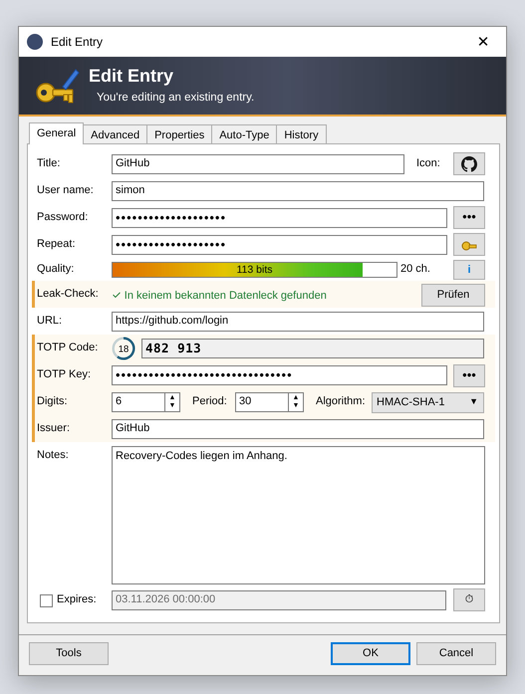

# BetterPass – Plugin für KeePass 2.x

[English](README.en.md) · **Deutsch**

[](LICENSE) [](https://github.com/Sormik/betterpass/releases/latest)

BetterPass erweitert KeePass 2.x (ab Version 2.47) um fünf Funktionen. Alle Einstellungen findest du unter **Tools → Options → BetterPass** oder unter **Tools → BetterPass → Einstellungen**.

> **Status:** Version 1.1.0. Profile und Passworterzeugung des Passwort-Generators sind mit KeePass 2.62 unter Windows 11 getestet, die Dialoge und die übrigen Funktionen noch nicht von Hand. Die Bilder unten sind gerenderte Vorschauen der geplanten Oberfläche, keine echten Screenshots.

| Eintragsdialog | Darkmode | Icon-Auswahl |
|---|---|---|
|  |  |  |

## Funktionen

### TOTP-Felder im Eintragsdialog
Im Tab **General** stehen unter **URL** folgende Felder:

- **TOTP Code**: eine flache Karte mit dem aktuellen Code in großer Schrift (die Zifferngruppen trennt ein gezeichneter Strich, der nie mitkopiert wird), einem schmalen Countdown-Ring (in den letzten 5 Sekunden orange) und einem Kopieren-Button. Kopieren geht auch per Doppelklick, Leertaste oder Strg+C. Die Zwischenablage wird nach dem eingestellten KeePass-Timeout automatisch geleert. Ohne Key oder bei ungültigem Key zeigt die Karte einen Hinweis.
- **TOTP Key**: standardmäßig maskiert. Ein eingefügter `otpauth://totp/...`-Link füllt alle Felder automatisch aus, dazu Titel und Benutzername, wenn diese noch leer sind.
- **Digits** (1–8), **Period**, **Algorithm** (SHA-1, SHA-256, SHA-512) und **Issuer**.

**Speicherformat:** BetterPass nutzt die nativen KeePass-Felder `TimeOtp-Secret-Base32`, `TimeOtp-Length`, `TimeOtp-Period` und `TimeOtp-Algorithm`, ergänzt um `TimeOtp-Issuer`. Dadurch funktioniert `{TIMEOTP}` in Auto-Type auch ohne das Plugin.

Ein KeePassXC-Feld `otp` wird gelesen. Beim Bearbeiten wird es nur dann aktualisiert, wenn BetterPass es vollständig verstanden hat. Daten, die BetterPass nicht verlustfrei schreiben kann, werden nur angezeigt und **nie überschrieben**. Das betrifft Steam-Codes, HOTP, unbekannte Parameter und Werte außerhalb des gültigen Bereichs. Bearbeiten lassen sie sich weiterhin im Tab **Advanced**.

Das Secret liegt im Speicher verschlüsselt vor (`ProtectedBinary` bzw. `SecureTextBoxEx` von KeePass).

### Have I Been Pwned
- **Im Eintragsdialog** zeigt die Zeile **Leak-Check**, ob das Passwort in bekannten Datenlecks vorkommt. Die Prüfung läuft automatisch, alternativ auf Knopfdruck.
- **Für die ganze Datenbank:** *Tools → BetterPass → Alle Passwörter mit Have I Been Pwned prüfen*. Betroffene Einträge erscheinen anschließend in der Eintragsliste. Auf Wunsch markiert BetterPass sie mit dem Tag `Pwned`.
- Optional prüft BetterPass nach dem Öffnen einer Datenbank automatisch im Hintergrund. Gemeldet wird nur, wenn etwas gefunden wurde.
- **Datenschutz:** An `api.pwnedpasswords.com` gehen nur die ersten 5 Zeichen des SHA-1-Hashes (k-Anonymität). Das Passwort selbst verlässt den Rechner nicht. Einträge im Papierkorb und Feldreferenzen (`{REF:…}`) werden übersprungen.

### Marken-Icons von thesvg.org
- **Rechtsklick → BetterPass → Icon von theSVG wählen** öffnet eine Suche mit Vorschau. Die Suche ist mit der Domain aus der URL vorbelegt. Das gewählte Icon gilt für alle markierten Einträge.
- **Passende Icons automatisch zuweisen** ordnet Icons anhand der URL-Domain und des Titels zu. Vor dem Zuweisen bekommst du eine Liste zur Bestätigung.
- Die Icons werden als PNG in der gewünschten Größe (32, 64 oder 128 px) als benutzerdefinierte KeePass-Icons gespeichert. Gleiche Icons legt BetterPass nicht doppelt an.
- Der Katalog (ca. 3,5 MB) und die geladenen SVGs liegen zwischengespeichert in `%LOCALAPPDATA%\KeePass\BetterPass\thesvg`.
- Alle Downloads laufen über die Netzwerkfunktionen von KeePass. Damit gelten deine Proxy- und TLS-Einstellungen. Die Marken gehören ihren jeweiligen Inhabern.

### Modernes Design
- **Design:** *Klassisch (KeePass)*, *Windows 11* oder *aethercert*. **Farbmodus:** *Hell*, *Dunkel* oder *Wie Windows* (folgt der Windows-Einstellung für Apps).
- **Windows 11:** neutrale Flächen im Stil von Windows 11, dazu die Akzentfarbe von Windows (für den Hauptbutton, Fokus, Tab-Markierung und den TOTP-Countdown).
- **aethercert:** die „Leather“-Farben des aethercert-Brandkits: Papier und Tinte, Leder für Struktur, Gold nur als einzelne Akzentlinie (Tab-Markierung, Dialogkopf). Warnungen sind orange, Radien 6 px, der TOTP-Code steht in einer Monospace-Schrift.
- **Eingabefelder:** abgerundet und mit etwas Innenabstand. Bei Windows 11 haben sie eine dunklere Unterkante, mit Fokus eine 2 px breite Linie in der Akzentfarbe und eine leicht veränderte Füllung. Bei aethercert haben sie den „input“-Rahmen des Brandkits und mit Fokus einen 2 px breiten Ring in der „ring“-Farbe. Das gilt für Textfelder, Auswahllisten, Zahlen- und Datumsfelder. Listen und Bäume bekommen einen abgerundeten Haarlinienrahmen.
- **Icons:** alle Icons in Menüs, Symbolleiste, Kontext- und Tray-Menü, in den Dialog-Buttons (Passwort anzeigen, Generator, Kalender, Tools, Hilfe …), im Dialogkopf sowie die 69 Standard-Icons für Einträge und Gruppen sind einfarbige Fluent-Icons aus der Windows-Symbolschrift (*Segoe Fluent Icons*, unter Windows 10 *Segoe MDL2 Assets*) in der Textfarbe des Designs. Abgelaufene und Warn-Einträge sind farbig markiert. Eigene Icons (z. B. Marken-Icons) bleiben unverändert. Ohne diese Schrift behält KeePass seine Icons.
- Ohne Schatten und 3D-Rahmen: Buttons und Checkboxen sind flach und abgerundet, Spin-Buttons und Auswahllisten flach. Tabs haben eine Markierung unter dem aktiven Tab, Menüs abgerundete Hover-Flächen und unter Windows 11 abgerundete Popups. Der Verlaufs-Banner der Dialoge wird flach, die Titelleiste hat die Fensterfarbe (Windows 11), und die Passwortqualität ist ein flacher Balken.
- Designwechsel wirken sofort. Zurück zu *Klassisch* wird erst nach einem Neustart von KeePass vollständig wirksam.
- Im Hochkontrastmodus von Windows bleibt KeePass klassisch. Native Windows-Elemente behalten ihr Aussehen, zum Beispiel Meldungsfenster, Datei-Dialoge, Datumsauswahl und das Standard-Kontextmenü in Textfeldern.
- Bisherige Einstellungen werden übernommen: *Darkmode aus* wird zu *Klassisch*, *Dunkel* und *Wie Windows* zu *Windows 11* mit demselben Farbmodus.

### Passwort-Generator im Stil bekannter Anbieter
BetterPass legt in KeePass' Passwort-Generator diese Profile an:

| Profil | Format | Beispiel |
|---|---|---|
| **BetterPass: Apple (Safari, iCloud-Schlüsselbund)** – Standard | 3 Gruppen à 6 Silben-Zeichen, genau 1 Großbuchstabe und 1 Ziffer, ca. 72 Bit | `hupvEw-bawpo6-xisqof` |
| BetterPass: Google Chrome | 15 Zeichen, Klein-/Großbuchstaben und Ziffern, ohne verwechselbare Zeichen | `Fn2RnaY7kb6Ue3e` |
| BetterPass: Microsoft Edge | 15 Zeichen inkl. Sonderzeichen | `UE-7T2RG0S@^ytX` |
| BetterPass: Mozilla Firefox | 15 Zeichen inkl. Sonderzeichen, ohne verwechselbare Zeichen | `CEoS@7n:33s8eq%` |
| BetterPass: 1Password | 20 Zeichen inkl. Sonderzeichen | `!B2Q0ZPylr_+Me-?~6Vb` |
| BetterPass: Bitwarden | 14 Zeichen, Klein-/Großbuchstaben und Ziffern | `LK3w07AzyO3Lho` |

- Jedes Profil enthält mindestens einen Klein-, einen Großbuchstaben und eine Ziffer (und, wo vorgesehen, ein Sonderzeichen). Die Formate folgen dem, was die Generatoren der Anbieter sichtbar erzeugen. Der Code der Anbieter wird nicht kopiert.
- Beim ersten Start legt BetterPass die Profile an und macht **Apple zum Standard für neue Einträge**. Danach ändert BetterPass daran nichts mehr. Gelöschte Profile bleiben gelöscht, ein anderer Standard bleibt bestehen.
- **Auswählen:** im Eintragsdialog über den Generator-Knopf neben dem Passwort oder unter **Tools → Generate Password**.
- **Anpassen:** In **Tools → Generate Password** ein Profil wählen, ändern und mit dem Speichern-Knopf als eigenes Profil ablegen. Beim Apple-Stil öffnet der Knopf **Options** die Einstellungen: Anzahl Gruppen, Zeichen pro Gruppe, Trennzeichen, Anzahl Großbuchstaben und Ziffern, mit Vorschau und Stärke-Anzeige. Dieselben Einstellungen gibt es unter **Tools → Options → BetterPass → Passwort-Generator**. Dort lassen sich auch der Standard für neue Einträge wählen und gelöschte Profile wiederherstellen.
- **Standards von KeePass:** Chrome, Edge, Firefox, 1Password und Bitwarden sind normale KeePass-Profile vom Typ *Muster* (Pattern) mit „Zeichen zufällig anordnen“. Sie funktionieren auch ohne BetterPass. Der Apple-Stil nutzt die offizielle KeePass-Schnittstelle für eigene Generatoren (*Generate using custom algorithm*), weil KeePass' eigene Generatoren keinen einzelnen Großbuchstaben an zufälliger Stelle innerhalb fester Gruppen erzeugen können. Ohne BetterPass ist dieses eine Profil nicht nutzbar.

## Installation

### Variante A: PLGX herunterladen (am einfachsten)

1. `BetterPass.plgx` aus dem [neuesten Release](https://github.com/Sormik/betterpass/releases/latest) herunterladen.
2. In den KeePass-Ordner `Plugins` kopieren (z. B. `C:\Program Files\KeePass Password Safe 2\Plugins`) und eine ältere `BetterPass.plgx` ersetzen.
3. KeePass neu starten.

### Variante B: PLGX selbst bauen (ohne Visual Studio)

1. Den Ordner `BetterPass` ablegen, z. B. unter `C:\Build\BetterPass`.
2. In der Eingabeaufforderung ausführen:
   ```
   "C:\Program Files\KeePass Password Safe 2\KeePass.exe" --plgx-create "C:\Build\BetterPass" --plgx-prereq-kp:2.47
   ```
3. Die erzeugte `BetterPass.plgx` (sie liegt neben dem Ordner) in den KeePass-Ordner `Plugins` kopieren.
4. KeePass neu starten.

KeePass kompiliert das Plugin beim ersten Start selbst. Dafür genügt das unter Windows 10/11 vorinstallierte .NET Framework 4.x.

**Wenn KeePass beim Start einen Fehler meldet:** KeePass mit `KeePass.exe --debug` starten und das Plugin erneut laden. Die Compiler-Meldungen landen dann in einer Datei im Temp-Ordner. Diese Meldungen brauche ich zur Fehlerbehebung.

### Variante C: DLL mit Visual Studio oder MSBuild

1. In `BetterPass.csproj` den `HintPath` auf deine `KeePass.exe` anpassen.
2. Bauen: `msbuild BetterPass.csproj /p:Configuration=Release`
3. `bin\Release\BetterPass.dll` in den KeePass-Ordner `Plugins` kopieren.

Den TOTP-Teil gab es zuvor als separates Plugin **TotpFields**. Falls du es installiert hast, entferne es vor der Installation von BetterPass. Sonst erscheinen die Felder doppelt.

## Hinweise zur Robustheit
- BetterPass sucht die Steuerelemente der KeePass-Dialoge über ihre internen Namen. Ändert eine künftige KeePass-Version einen Dialog, fügt BetterPass dort nichts ein und stürzt nicht ab.
- Bearbeitest du mehrere Einträge gleichzeitig, bleibt der Eintragsdialog unverändert.
- In der schreibgeschützten Ansicht sind alle Felder nur lesbar.
- Netzwerkzugriffe laufen im Hintergrund und blockieren die Oberfläche nicht. Ohne Internet funktioniert alles außer HIBP und dem ersten Laden der Icons.

## Projektstruktur
```
BetterPassExt.cs         Einstieg, Menüs, Fenster-Hooks
Core/                    Einstellungen, Netzwerk, Layout-Helfer für den Eintragsdialog
Totp/                    TOTP-Berechnung, Code-Karte, Felder im Eintragsdialog
Hibp/                    Have-I-Been-Pwned-Client, Dialogzeile, Datenbankprüfung
Icons/                   theSVG-Katalog, SVG-Renderer (GDI+), Auswahl-Dialog
Theme/                   Design (Windows 11, aethercert), Painter für Steuerelemente
Options/                 Einstellungs-Tab und -Dialog
PwGen/                   Passwort-Generator: Silben-Generator (Apple-Stil), Profile, Optionen-Dialog
UI/                      Fortschrittsdialog
```
Der gesamte Code ist C# 5, damit KeePass ihn als PLGX kompilieren kann.

## Mitmachen
Fehlerberichte, Ideen und Pull Requests sind willkommen, auf Deutsch oder Englisch. Wie es geht, steht in [CONTRIBUTING.md](CONTRIBUTING.md). Sicherheitslücken bitte nicht öffentlich melden, sondern wie in [SECURITY.md](SECURITY.md) beschrieben. Es gilt der [Verhaltenskodex](CODE_OF_CONDUCT.md). Alle Änderungen stehen im [CHANGELOG](CHANGELOG.md).

## Lizenz
Copyright (C) 2026 Simon Müller

BetterPass ist freie Software unter der [GNU General Public License, Version 3 oder neuer](LICENSE) (GPL-3.0-or-later). Du darfst das Plugin nutzen, verändern und weitergeben. Wer veränderte Versionen weitergibt, muss deren Quellcode unter derselben Lizenz bereitstellen. BetterPass wird ohne jede Gewährleistung bereitgestellt.

BetterPass ist ein Plugin für [KeePass](https://keepass.info/) und steht in keiner Verbindung zum KeePass-Projekt. Apple, Google, Microsoft, Mozilla, 1Password, Bitwarden und alle weiteren genannten Namen sind Marken ihrer jeweiligen Inhaber. Sie werden nur genannt, um das nachgebildete Passwortformat zu beschreiben. Details zu Marken und externen Diensten stehen in [NOTICE.md](NOTICE.md).
