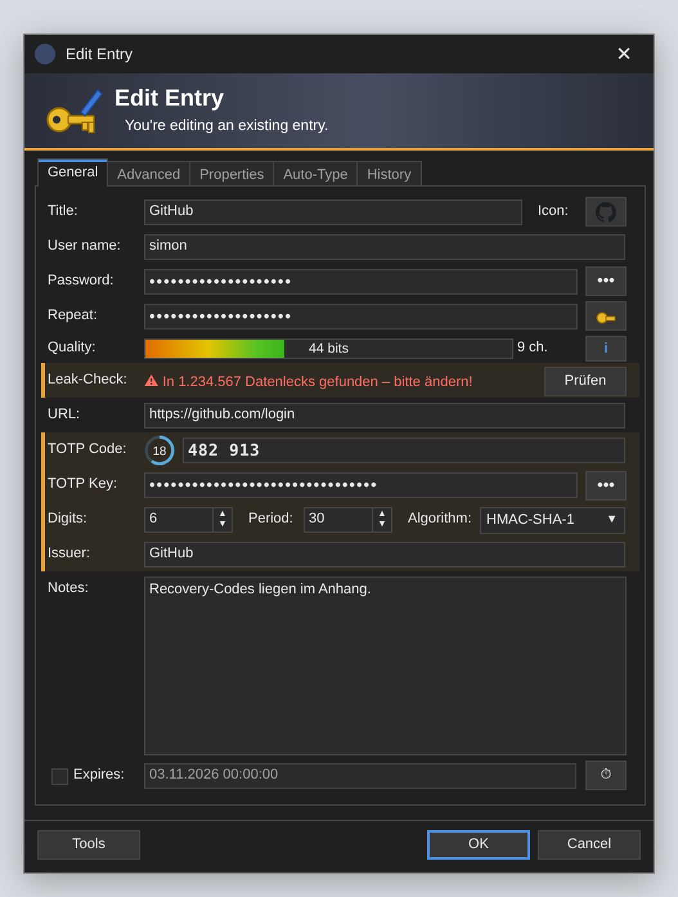
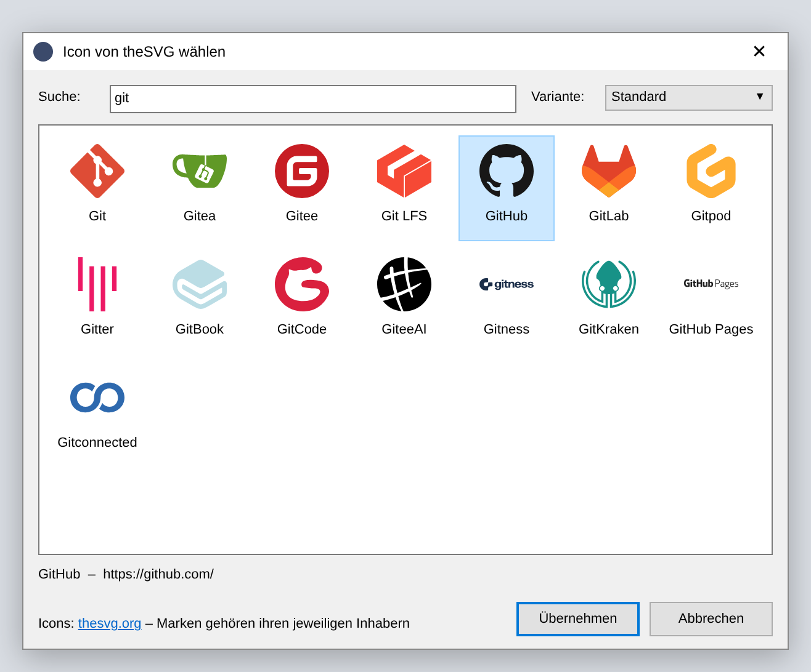

# BetterPass – Plugin für KeePass 2.x

BetterPass erweitert KeePass 2.x (ab Version 2.47) um vier Funktionen. Alle Einstellungen findest du unter **Tools → Options → BetterPass** oder unter **Tools → BetterPass → Einstellungen**.

> **Status:** Version 1.0.0, noch nicht auf Windows getestet. Die Bilder unten sind gerenderte Vorschauen der geplanten Oberfläche, keine echten Screenshots.

| Eintragsdialog | Darkmode | Icon-Auswahl |
|---|---|---|
|  |  |  |

## Funktionen

### TOTP-Felder im Eintragsdialog
Im Tab **General** stehen unter **URL** folgende Felder:

- **TOTP Code**: der aktuelle Code mit Countdown-Ring. Ein Doppelklick kopiert ihn. Die Zwischenablage wird nach dem eingestellten KeePass-Timeout automatisch geleert.
- **TOTP Key**: standardmäßig maskiert. Ein eingefügter `otpauth://totp/...`-Link füllt alle Felder automatisch aus, dazu Titel und Benutzername, wenn diese noch leer sind.
- **Digits** (1–8), **Period**, **Algorithm** (SHA-1, SHA-256, SHA-512) und **Issuer**.

**Speicherformat:** BetterPass nutzt die nativen KeePass-Felder `TimeOtp-Secret-Base32`, `TimeOtp-Length`, `TimeOtp-Period` und `TimeOtp-Algorithm`, ergänzt um `TimeOtp-Issuer`. Dadurch funktioniert `{TIMEOTP}` in Auto-Type auch ohne das Plugin.

Ein KeePassXC-Feld `otp` wird gelesen. Beim Bearbeiten wird es nur dann aktualisiert, wenn BetterPass es vollständig verstanden hat. Daten, die BetterPass nicht verlustfrei schreiben kann, werden nur angezeigt und **nie überschrieben**. Das betrifft Steam-Codes, HOTP, unbekannte Parameter und Werte außerhalb des gültigen Bereichs. Bearbeiten lassen sie sich weiterhin im Tab **Advanced**.

Das Secret liegt im Speicher verschlüsselt vor (`ProtectedBinary` bzw. `SecureTextBoxEx` von KeePass).

### Have I Been Pwned
- **Im Eintragsdialog** zeigt die Zeile **Leak-Check**, ob das Passwort in bekannten Datenlecks vorkommt. Die Prüfung läuft automatisch, alternativ auf Knopfdruck.
- **Für die ganze Datenbank:** *Tools → BetterPass → Alle Passwörter mit Have I Been Pwned prüfen*. Betroffene Einträge erscheinen anschließend in der Eintragsliste. Auf Wunsch markiert BetterPass sie mit dem Tag `Pwned`.
- Optional prüft BetterPass nach dem Öffnen einer Datenbank automatisch im Hintergrund. Gemeldet wird nur, wenn etwas gefunden wurde.
- **Datenschutz:** An `api.pwnedpasswords.com` gehen nur die ersten 5 Zeichen des SHA-1-Hashes (k-Anonymität). Das Passwort selbst verlässt den Rechner nicht. Einträge im Papierkorb und Feldreferenzen (`{REF:…}`) werden übersprungen.

### Marken-Icons von thesvg.org
- **Rechtsklick → BetterPass → Icon von theSVG wählen** öffnet eine Suche mit Vorschau. Die Suche ist mit der Domain aus der URL vorbelegt. Das gewählte Icon gilt für alle markierten Einträge.
- **Passende Icons automatisch zuweisen** ordnet Icons anhand der URL-Domain und des Titels zu. Vor dem Zuweisen bekommst du eine Liste zur Bestätigung.
- Die Icons werden als PNG in der gewünschten Größe (32, 64 oder 128 px) als benutzerdefinierte KeePass-Icons gespeichert. Gleiche Icons legt BetterPass nicht doppelt an.
- Der Katalog (ca. 3,5 MB) und die geladenen SVGs liegen zwischengespeichert in `%LOCALAPPDATA%\KeePass\BetterPass\thesvg`.
- Alle Downloads laufen über die Netzwerkfunktionen von KeePass. Damit gelten deine Proxy- und TLS-Einstellungen. Die Marken gehören ihren jeweiligen Inhabern.

### Darkmode
- Zur Wahl stehen **Aus**, **Dunkel** und **Wie Windows**. Bei „Wie Windows“ folgt KeePass der Windows-Einstellung für Apps.
- Gefärbt werden Hauptfenster, Dialoge, Menüs, Symbolleisten, Listen, Tabs und die Titelleiste (ab Windows 10).
- Das Einschalten wirkt sofort. Das Ausschalten wird erst nach einem Neustart von KeePass vollständig wirksam.
- Im Hochkontrastmodus von Windows bleibt der Darkmode aus. Native Windows-Elemente bleiben hell, zum Beispiel Meldungsfenster, Datei-Dialoge und das Standard-Kontextmenü in Textfeldern.

## Installation

### Variante A: PLGX (empfohlen, ohne Visual Studio)

1. Den Ordner `BetterPass` ablegen, z. B. unter `C:\Build\BetterPass`.
2. In der Eingabeaufforderung ausführen:
   ```
   "C:\Program Files\KeePass Password Safe 2\KeePass.exe" --plgx-create "C:\Build\BetterPass" --plgx-prereq-kp:2.47
   ```
3. Die erzeugte `BetterPass.plgx` (sie liegt neben dem Ordner) in den KeePass-Ordner `Plugins` kopieren.
4. KeePass neu starten.

KeePass kompiliert das Plugin beim ersten Start selbst. Dafür genügt das unter Windows 10/11 vorinstallierte .NET Framework 4.x.

**Wenn KeePass beim Start einen Fehler meldet:** KeePass mit `KeePass.exe --debug` starten und das Plugin erneut laden. Die Compiler-Meldungen landen dann in einer Datei im Temp-Ordner. Diese Meldungen brauche ich zur Fehlerbehebung.

### Variante B: DLL mit Visual Studio oder MSBuild

1. In `BetterPass.csproj` den `HintPath` auf deine `KeePass.exe` anpassen.
2. Bauen: `msbuild BetterPass.csproj /p:Configuration=Release`
3. `bin\Release\BetterPass.dll` in den KeePass-Ordner `Plugins` kopieren.

Den TOTP-Teil gab es zuvor als separates Plugin **TotpFields**. Falls du es installiert hast, entferne es vor der Installation von BetterPass. Sonst erscheinen die Felder doppelt.

## Hinweise zur Robustheit
- BetterPass sucht die Steuerelemente der KeePass-Dialoge über ihre internen Namen. Ändert eine künftige KeePass-Version einen Dialog, fügt BetterPass dort nichts ein und stürzt nicht ab.
- Bearbeitest du mehrere Einträge gleichzeitig, bleibt der Eintragsdialog unverändert.
- In der schreibgeschützten Ansicht sind alle Felder nur lesbar.
- Netzwerkzugriffe laufen im Hintergrund und blockieren die Oberfläche nicht. Ohne Internet funktioniert alles außer HIBP und dem ersten Laden der Icons.

## Projektstruktur
```
BetterPassExt.cs         Einstieg, Menüs, Fenster-Hooks
Core/                    Einstellungen, Netzwerk, Layout-Helfer für den Eintragsdialog
Totp/                    TOTP-Berechnung, Ring, Felder im Eintragsdialog
Hibp/                    Have-I-Been-Pwned-Client, Dialogzeile, Datenbankprüfung
Icons/                   theSVG-Katalog, SVG-Renderer (GDI+), Auswahl-Dialog
Theme/                   Darkmode
Options/                 Einstellungs-Tab und -Dialog
UI/                      Fortschrittsdialog
```
Der gesamte Code ist C# 5, damit KeePass ihn als PLGX kompilieren kann.
